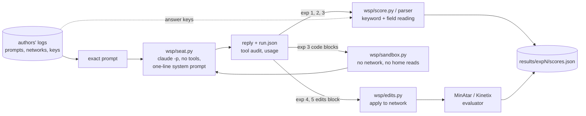

# Human.md: how this repository works

## What it does

It reruns the experiments of "Sparks of Weight-Space Programming" (Takehi, Teoh, Zhang and Khattab, MIT CSAIL,
November 2026) with **Claude Opus 5.5** in place of the post's GPT-6 Astra. Each experiment sends the authors'
exact released prompt to Opus through a tool-free Claude Code seat, applies or parses the reply exactly as the
authors' harness did, and scores it against the authors' ground truth. The authors' prompts, networks and answer
keys are read from a clone of their logs repository, never copied here.

## Where execution starts

Each experiment is one script at the repo root:

| Script | Experiment | What it needs |
|---|---|---|
| `exp1_2_read.py` | 1 (which game) and 2 (which shape), one reply each, no tools | `claude` CLI |
| `exp3_language.py` | 3 (which corpus, which heads copy), multi-turn with a Python sandbox | `claude`, `.venv-sandbox` |
| `exp4_fix_car.py` | 4 (fix a failing Kinetix car policy), one reply | `claude`, `.venv-kinetix` |
| `exp5_write.py` | 5 (write MinAtar policies from scratch), one reply each | `claude`, `.venv` (MinAtar) |
| `exp6_go.py` | 6 at budget 0 (write a 1.5M-weight Go network), multi-turn with a Python sandbox | `claude`, `.venv-go` (pgx) |
| `exp7_build_models.sh` | 7, step 1: rebuild the six Gemma fine-tunes with the authors' scripts | `.venv-train` |

Every script is resumable: a turn whose `run.json` records a clean reply is not asked again, so rerunning a script
only rescores.

## The main flow

## The important files

- `wsp/seat.py`: the only place the model is called. One `claude -p` call per turn with `--tools ""`, no MCP, no
  settings or hooks, CLAUDE.md and memory disabled, a neutral working directory, and the authors' system prompt
  "Answer the user's request." It records each turn as `prompt.txt`, `events.jsonl`, `answer.md` and `run.json`
  (model, effort, usage, wall time, and `audit.tool_free`).
- `wsp/edits.py`: the authors' `edits` language (Experiments 4 and 5). Verified to reproduce the authors' own
  reading of Astra's replies exactly (`tests/test_exp5_against_authors.py`).
- `wsp/minatar_eval.py`: the Experiment 5 scorer (MinAtar 1.0.15, sticky actions 0.1, 1,000 episodes, 10,000-step
  cap). Verified: the authors' three networks score within 1.4 standard errors of their reported means.
- `wsp/kinetix_eval.py`: the Experiment 4 evaluator (Kinetix car-ramp level, 256 search and 1,024 test episodes).
  Verified: the base network fails 256 / 256 and Astra's edit succeeds 1,024 / 1,024 in 73 steps, as reported.
- `wsp/go_eval.py`: 9x9 Go head-to-heads on pgx (Experiment 6). Verified on six of the authors' records.
- `wsp/sandbox.py`: the macOS `sandbox-exec` counterpart of the authors' bubblewrap sandbox.
- `wsp/conversation.py`: the multi-turn loop (run a block, send its output back, stop at a reply without one),
  resumable from `state.json` after an interruption. Experiment 3 has its own copy, the one its runs used.
- `scrub_paths.py`: replaces this machine's paths in `results/` with `<home>` / `<scratch>` / `<tmp>` before
  publishing.
- `wsp/score.py`: reading the `Game:` / `Images:` / `Confidence:` fields and mapping them to classes.
- `wsp/ref.py` and `fetch_ref.sh`: where the authors' logs live, pinned to commit `4d09ba6`.
- `results/expN/`: every turn Opus saw and sent, plus `scores.json`.

## Where to read next

`README.md` has the results next to the post's numbers and every way this run differs from the authors'. Each
experiment script's docstring states its protocol and which of the authors' files it reproduces.
